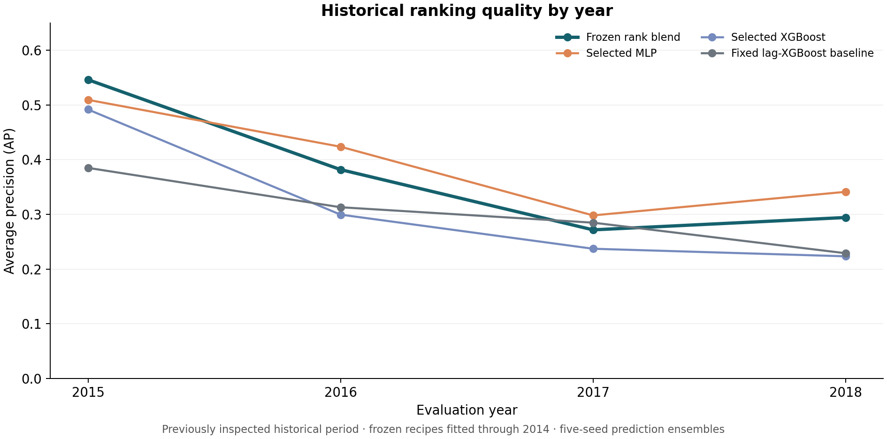
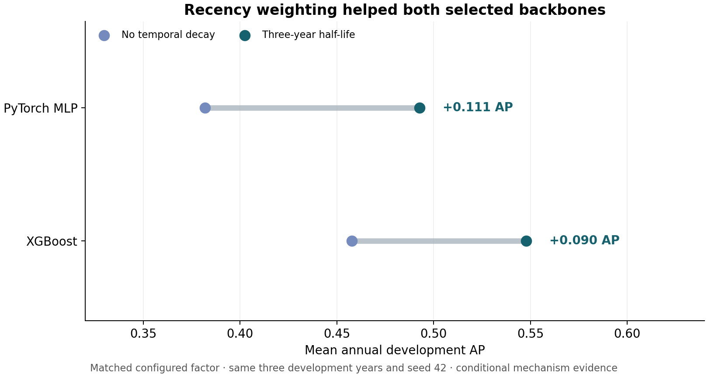

# Corporate Financial Distress Classification

## Project Overview

I built a machine learning and deep learning pipeline that uses historical financial statements from U.S. companies to classify firm-year records labeled **failed** and rank financial distress risk. The dataset contains **78,682 firm-year records from 8,971 companies**, covering 1999–2018, with financial inputs such as assets, liabilities, earnings, and revenue.

The project combines financial feature engineering, expanding-window validation, time-weighted training, XGBoost, PyTorch MLPs, parameter optimization, multiple training seeds, and a development-selected rank blend. It is an individual extension of a UCLA MFE 413 team project, developed with disclosed Codex assistance.

**[English research report](reports/Research_Report_EN.pdf) · [Chinese research guide](reports/Research_Guide_CN.pdf) · [Executed results notebook](notebooks/02_Model_Comparison.ipynb)**

## Key Results

The final model averages within-year percentile ranks from five-seed XGBoost and MLP prediction ensembles, with **50% weight on each model**. Recipes and blend weights were frozen using 2009–2013 development evidence, before a single 2014 confirmation batch and the 2015–2018 historical evaluation.

| Historical evaluation metric | Frozen rank blend | Strongest same-cutoff baseline |
| --- | ---: | ---: |
| Mean annual average precision (AP) | **0.373** | 0.303 |
| Annual AP difference | **+0.070** | — |
| Pooled ROC-AUC | **0.922** | 0.853 |
| Mean annual Recall@Top 5% | **62.0%** | 51.3% |

The reference is the fixed lag-feature XGBoost baseline, retrained through the same 2014 cutoff with five seeds. AP and review recall are averaged equally over the four evaluation years; ROC-AUC pools the years. The blend uses annual ranks, while the reference row above uses mean raw scores; matching rank references and every evaluated model are retained in the [complete comparison](results/model_comparison.csv) and [unaltered source table](results/historical_2015_2018.csv).

These are **retrospective classification results**. Labels are a company's fixed ultimate failed/alive status, and the historical period was previously inspected. The results do not establish one-year bankruptcy prediction or performance on a new untouched test set.

## Methodology

1. **Audit the data.** Pin the authorized snapshot by SHA-256, inspect company-constant labels, remove duplicate financial inputs where appropriate, and preserve valid negative accounting values.
2. **Build financial features.** Compare raw accounts, signed-log transforms, ratios, and exact-calendar histories. Fit imputation, clipping, scaling, and numerical representations within each training role.
3. **Validate through time.** Screen on expanding calendar folds, then compare shortlisted recipes over all five development years and three seeds. Keep 2014 confirmation separate from model selection.
4. **Optimize and stabilize.** Compare tree and neural families, refine parameters, test resampling against matched update budgets, and evaluate recency weights. Both final recipes use a three-year weighting half-life.
5. **Freeze and evaluate.** Refit five seeds through 2014, average predictions within each family, convert them to within-year percentile ranks, and apply the frozen equal-weight blend. Report annual metrics, paired company bootstrap intervals, and company stress diagnostics.

[Detailed methods](docs/METHODOLOGY.md) · [Frozen recipes](configs/final_model.json) · [Data card](docs/DATA_CARD.md) · [Model selection record](docs/MODEL_SELECTION.md)

## Visual Results



The annual view shows both the improvement over the baseline and substantial variation across historical years. All series above are prediction ensembles, rather than averages of individual seed metrics.



In matched development controls, a three-year half-life improved mean annual AP for both backbones. These are conditional development findings; they do not isolate a causal source of the entire historical gain.

## Research Findings

- **Recency weighting helped both selected families.** In the same three development years and seed, XGBoost AP increased from 0.458 to 0.548 and MLP AP from 0.382 to 0.493. [Matched controls](results/optimization_controls.csv)
- **More complexity was not uniformly better.** Compact ratios, longer histories, numerical embeddings, larger networks, and ranking losses did not consistently improve their matched references. Negative and incomplete experiments remain in the [trial ledger](results/trials.csv), [attempt history](results/trial_attempts.csv), and [coverage table](results/trial_coverage.csv).
- **Training budget changes can resemble sampling gains.** Equal epochs after oversampling produce more optimizer updates. The study therefore records actual updates and class exposures, including fixed-2,000-update controls. [Budget comparison](results/training_budget_ablation.csv)
- **The blend was selected before historical scoring.** It achieved development annual AP 0.582 versus 0.539 for the MLP-only rank ensemble. On the already-exposed historical period, MLP alone reached annual AP 0.393, above the blend's 0.373. The official result keeps the development-frozen blend; choosing MLP afterward would rewrite selection. [Selection explanation](docs/MODEL_SELECTION.md)
- **Company novelty remains difficult.** The natural unseen-company cohort has only five failed companies. Post-selection company-group stress is weaker and does not establish prospective generalization. [Stress results](results/company_stress_summary.csv)

## Reports & Code

| Artifact | Direct link |
| --- | --- |
| English research report | [PDF](reports/Research_Report_EN.pdf) · [Current reading guide](reports/Research_Report_EN.md) |
| Chinese research and teaching report | [PDF](reports/Research_Guide_CN.pdf) · [Current reading guide](reports/Research_Guide_CN.md) |
| Executed model comparison notebook | [Open notebook](notebooks/02_Model_Comparison.ipynb) |
| Data and financial feature walkthrough | [Open notebook](notebooks/01_Data_and_Features.ipynb) |
| Complete historical model comparison | [Readable table](results/MODEL_COMPARISON.md) · [CSV](results/model_comparison.csv) · [Source ledger](results/baseline_bridge.csv) |
| Selected models and preprocessing | [Training](src/distress_v2/training.py) · [Features](src/distress_v2/data.py) · [Preprocessing](src/distress_v2/preprocessing.py) · [Networks](src/distress_v2/networks.py) |
| Reproducible configuration | [Final recipe index](configs/final_model.json) · [Original selection freeze](configs/selection_freeze.json) · [Registered protocol](configs/protocol.yaml) |
| Evidence and research history | [Results index](results/README.md) · [Research provenance](docs/RESEARCH_HISTORY.md) |

The existing PDFs preserve the frozen reports byte for byte. Their original research-stage labels identify historical evidence; this repository root and the reading guides provide the single current project entry point.

## Reproduction

Use Python 3.13 for the recorded environment. Public verification and both notebooks work without the dataset or serialized models.

```bash
python3.13 -m venv .venv
.venv/bin/python -m pip install -r requirements-lock.txt
.venv/bin/python -m pip install --no-deps --no-build-isolation -e .
scripts/run.sh -m pytest -q
scripts/run.sh scripts/verify_project.py
scripts/run.sh scripts/execute_notebooks.py
scripts/run.sh -m distress_v2.cli status
```

To inspect a training replication without starting it:

```bash
export DISTRESS_DATA=/absolute/path/to/american_bankruptcy.csv
scripts/run.sh scripts/reproduce.py --output artifacts/replications/check
```

A separately registered recipe replay requires `--run` and writes only to a fresh ignored output directory. It reuses the frozen choices; it cannot create a new independent holdout or guarantee identical results across hardware. Original private model reloads and source-role reconstruction need the owner's authorized local artifacts. Read [installation, replay, and verification instructions](docs/REPRODUCTION.md).

```text
src/         Models, preprocessing, evaluation, and shared utilities
configs/     Frozen recipes, protocol, and per-trial configurations
scripts/     Verification, notebook execution, and isolated recipe replay
notebooks/   Executed data and model walkthroughs
results/     Aggregate tables, figures, and verification receipts
reports/     English and Chinese research reports
docs/        Methods, limitations, attribution, and research provenance
tests/       Synthetic leakage, metric, preprocessing, and model contracts
```

## Limitations & Attribution

The company label is fixed across its observed records. Actual failure dates, statement publication dates, and point-in-time accounting availability are not verified. The 2015–2018 period was inspected during earlier research. Company-bootstrap intervals condition on the fitted models and observed companies, excluding the full uncertainty of model selection and macroeconomic regimes. Scores support a research ranking demonstration, not calibrated annual default probabilities, production lending, or investment profitability.

**Qidian (Martin) Xing** directed the individual extension. The earlier course project is a team achievement; the original seven authors are listed in [acknowledgements](ACKNOWLEDGEMENTS.md). Codex assisted with implementation, experiments, checks, analysis, and documentation. See [contributions](docs/CONTRIBUTIONS.md), [AI use](docs/AI_USAGE.md), and [sources](docs/REFERENCES.md). No independent human-only implementation or personal mastery of every component is asserted.

Raw or processed observations, company-level predictions, serialized models, private source archives, and personal materials are excluded. The exact authorized dataset is required for numerical replay; the public upstream CSV has matching IDs/years/labels but different financial values. No open-source license has been added; [license status](LICENSE_NOTICE.md) and third-party rights remain unchanged.
