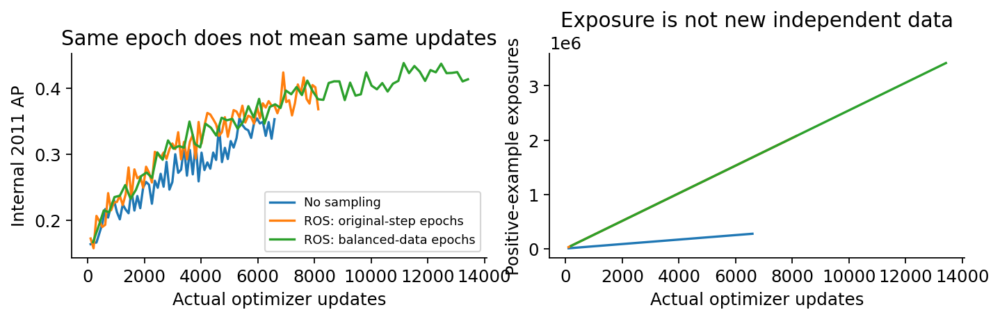

# 性能优化 V2：实测性能对照

Qidian (Martin) Xing | 78,682条公司年度记录、8,971家公司；截至2014可用于拟合66,400条。2015-2018共12,282条，已被多轮查看。

| Recipe | Cutoff | Input | Sel | Seeds | Yr AP | Pool AP | ROC | R@5 | Min | Source |
| --- | --- | --- | --- | --- | --- | --- | --- | --- | --- | --- |
| V0 base | 2011 | 18/01 | Y | 1 | NA | 0.145 | 0.835 | NA | NA | Archive |
| V0 L1 | 2011 | 13/01 | N | 1 | NA | 0.295 | 0.858 | NA | NA | Archive |
| V1 RF | 2012 | S1 | Y | 1 | 0.215 | 0.206 | 0.862 | 0.460 | 0.428 | V1 |
| V1 DL | 2012 | S1 | Y | 1 | 0.110 | 0.105 | 0.815 | 0.294 | 0.602 | V1 |
| P2 old L1 | 2014 | L1/01 | Pre | 5 | 0.262 | 0.259 | 0.862 | 0.524 | 2.798 | Mean score |
| P2 lag XGB | 2014 | Lag3/V1 | Pre | 5 | 0.303 | 0.296 | 0.853 | 0.513 | 0.605 | Mean score |
| P2 Cat raw | 2014 | RAW/V1 | Pre | 5 | 0.279 | 0.271 | 0.852 | 0.488 | 0.583 | Mean score |
| P2 V1 RF | 2014 | S1/V1 | Pre | 5 | 0.286 | 0.286 | 0.891 | 0.504 | 1.399 | Mean score |
| P2 V1 DL | 2014 | S1/V1 | Pre | 5 | 0.228 | 0.214 | 0.874 | 0.462 | 1.057 | Mean score |
| P2 overall | 2014 | LEGACY33/native/half-life3 | Y | 5 | 0.313 | 0.325 | 0.904 | 0.540 | 0.331 | Mean score |
| P2 DL | 2014 | RAW17/01/half-life3 | Y | 5 | 0.393 | 0.392 | 0.912 | 0.621 | 5.487 | Mean score |
| P2 blend | 2014 | annual ranks | Y | 5 | 0.373 | 0.383 | 0.922 | 0.620 | NA | Rank blend |
| Rank old L1 | 2014 | annual ranks | Pre | 5 | 0.262 | 0.254 | 0.861 | 0.524 | NA | Rank reference |
| Rank lag XGB | 2014 | annual ranks | Pre | 5 | 0.303 | 0.300 | 0.853 | 0.513 | NA | Rank reference |
| Rank Cat raw | 2014 | annual ranks | Pre | 5 | 0.279 | 0.270 | 0.851 | 0.488 | NA | Rank reference |
| Rank V1 RF | 2014 | annual ranks | Pre | 5 | 0.286 | 0.281 | 0.892 | 0.504 | NA | Rank reference |

开发期选定的固定年度rank融合，历史年度 AP=0.373；冻结的同截止年强基准中，点估计最高的是 baseline_v1_lags_xgb（0.303），差值 +0.070。年度AP点估计超过四条强基准。四组配对年度 AP 区间下界均为正，但仍只是固定模型与当前样本下的条件证据。

Yr AP 为历史四年AP等权均值；Pool AP与ROC为合并统计；R@5为逐年Top5%召回均值。Min为拟合计时分钟；seed mean先平均预测再评分。Sel表示各版本/家族内选定；Archive为旧档案，不是新实验。年度ROC guardrail另见selection_trace，完整身份见baseline_bridge.csv。

# 2. 旧版为何曾经更好：证据与边界

| 单年控制配方 | 2012 AP | 秒 |
| --- | --- | --- |
| xgb_raw_keepbest | 0.239 | 0.654 |
| legacy192_s1 | 0.206 | 22.082 |
| legacy192_raw18 | 0.249 | 59.504 |
| xgb_LAGS_RAW3 | 0.333 | 6.668 |
| legacy192_inner_l1 | 0.214 | 170.366 |
| xgb_RATIO_CORE | 0.291 | 6.149 |
| xgb_RAW17 | 0.285 | 1.123 |
| legacy192_epochrefit | 0.256 | 62.872 |
| legacy192_raw17 | 0.325 | 196.214 |
| legacy192_clip005 | 0.314 | 157.399 |
| legacy192_quantile | 0.243 | 26.896 |
| legacy64_raw18 | 0.259 | 18.227 |
| legacy192_keepbest | 0.263 | 37.591 |
| legacy192_unweighted | 0.364 | 117.674 |
| legacy192_ros_steps | 0.392 | 141.263 |
| legacy192_ros_epochs | 0.417 | 234.856 |

可确认：旧 Residual 为 192×4、约30万参数；V1 选定网络为64×2、36,801参数、ROS、18个最终epoch。输入、截尾、损失权重、停止与重拟合角色也不同。旧AP函数与sklearn在真实保存分数及ties样例上相同，不能把差距归咎于指标定义。

这些控制实验固定2012评分年与seed42，只支持该环境下的机制诊断。大容量并非自动更优，单个高分也不能证明普遍欠拟合或过拟合。固定旧13列含原2012-2014选择信息，只用于档案角色重训；正式开发每折重新执行L1。原包中epoch31的checkpoint与桥接表epoch23不同，身份分别保留。

2012单年对照中，RAW18同配置将容量192×4改为64×2，AP从0.249到0.259，并不支持‘更大必更好’。仅去掉原始重复列为0.325，仅取消完整类别加权为0.364。这些验证了局部机制的敏感性，尚不能解释整段历史的新旧差距。

旧角色实跑：固定13列原训练循环重训的 pooled AP=0.225；原包epoch31 checkpoint重载为0.140。前者未复现档案0.295，后者不是档案epoch23。已纠正这两条档案复算的缓存行序错误，并对全部47个冻结流水线逐行重载核验；没有新增训练或改变选择。

# 3. 采样、数值处理与真实训练预算

| 固定更新控制 | 更新次数 | 正类曝光 | 训练BCE |
| --- | --- | --- | --- |
| bridge_equal2000_none__seed42__year2012 | 2000 | 80778 | 0.246 |
| bridge_equal2000_smote__seed42__year2012 | 2000 | 509988 | 0.498 |
| bridge_equal2000_ros__seed42__year2012 | 2000 | 509988 | 0.480 |

另做无采样、ROS、SMOTE各2,000次更新控制。NN比较旧1/99%截尾、0.5/99.5%、稳健尺度与训练内normal quantile；二元mask不做quantile。仅在训练角色移除常量和重复mask，保留全部记录。数值embedding使用官方模块，TabM逐head求BCE后平均，推断平均sigmoid概率。

V2迁移的V1 ROS epoch重拟合曾遗漏采样后行数，已将那条trial标记无效、保留证据并重跑；这是本轮迁移修复，不能拿来解释原V1下降。主搜索固定step分支不受影响。

# 4. 搜索不是模型名单：覆盖与选择

| 家族 | 完成配置 | 失败 | 剪枝 |
| --- | --- | --- | --- |
| catboost | 36 | 0 | 0 |
| xgboost | 36 | 0 | 0 |
| random_forest | 6 | 0 | 0 |
| extra_trees | 6 | 0 | 0 |
| legacy_residual | 6 | 0 | 0 |
| mlp | 6 | 0 | 0 |
| num_mlp | 6 | 0 | 0 |
| tabm | 6 | 0 | 0 |
| official_ft | 0 | 0 | 0 |
| xgb_rank | 0 | 0 | 0 |

初筛2009/2011/2013；入围补齐2009-2013五年，再按42/2026/31415三seed×年度平均选择。每家最多2个、总共最多8个；AP差0.005以内按近期年度AP、Top5召回和成本取舍。强旧配方、LAGS、CatBoost与原RF基准均可入围，不强迫新模型或S1胜出。

# 5. 是否超过强旧配方，而非弱Logistic

开发期选定的固定年度rank融合，历史年度 AP=0.373；冻结的同截止年强基准中，点估计最高的是 baseline_v1_lags_xgb（0.303），差值 +0.070。年度AP点估计超过四条强基准。四组配对年度 AP 区间下界均为正，但仍只是固定模型与当前样本下的条件证据。

描述性对照：整体单配方的原始 pooled AP=0.325，旧L1档案=0.295（差+0.029）。两者截止年、选择和seed角色不同，不能把这个档案差值归因于算法；它与同截止年的年度AP比较分开。

| 同协议强基准 | 年度AP差下界 | 上界 | 有效抽样 |
| --- | --- | --- | --- |
| baseline_legacy_strong_inner_l1 | 0.039 | 0.186 | 2000 |
| baseline_v1_lags_xgb | 0.002 | 0.144 | 2000 |
| baseline_v1_raw_catboost | 0.029 | 0.166 | 2000 |
| baseline_v1_selected_rf | 0.032 | 0.148 | 2000 |

旧档案L1的pooled AP=.295332来自训练截至2011、验证2012-2014选epoch的单seed配置，且不是原验证ROC规则选中的代表。P2所有强基准与新模型均按同一截止2014重训。不能把P1/P2截止年差异、年度rank归一化或seed融合收益全部叫作新算法提升。

# 本轮究竟改了什么：用新结果回答

overall 选定配方：{"depth": 8, "family": "xgboost", "features": "LEGACY33", "half_life": 3, "iterations": 1500, "learning_rate": 0.07016184471619624, "preprocess": "native", "sampling": "none", "weight_alpha": 0}；五年×三seed AP=0.529。

DL 选定配方：{"depth": 2, "family": "mlp", "features": "RAW17", "half_life": 3, "learning_rate": 0.001, "preprocess": "std01", "sampling": "none", "schedule": "fixed", "weight_alpha": 0, "width": 128}；五年×三seed AP=0.500。

| 主干 | 输入/尺度 | 无embedding AP | PLE AP | 变化 |
| --- | --- | --- | --- | --- |
| num_mlp | RAW/01 | 0.382 | 0.357 | -0.025 |
| num_mlp | Log/QT | 0.324 | 0.356 | 0.033 |
| tabm | RAW/01 | 0.323 | 0.351 | 0.029 |
| tabm | Log/QT | 0.231 | 0.301 | 0.070 |

| 2014 一次确认 | AP | ROC | R@5 |
| --- | --- | --- | --- |
| Overall | 0.572 | 0.906 | 0.592 |
| DL | 0.527 | 0.905 | 0.556 |
| legacy_strong_inner_l1 | 0.311 | 0.823 | 0.430 |
| v1_lags_xgb | 0.311 | 0.822 | 0.401 |
| v1_selected_rf | 0.422 | 0.877 | 0.493 |

神经网络单配方：选定DL年度 AP=0.393；同截止年V1 DL=0.228（差+0.165），旧强L1配方=0.262（差+0.131）。这些是先平均五seed预测再评分的历史点估计，稳定性与区间另列。

PLE差异仅是同主干、单seed、三个开发年的成对结果。最终配方同时改变多项时，只能归因于整条流水线；2014不会触发重选。

固定选定配方和seed42，仅改变训练截止规则：截至2012的年度AP=0.242，截至2014=0.305。这是用过2013选择信息的P2迁移，不能冒称严格P1；滚动窗配方同时按相同窗长规则移动起点。

计算预算：首个8小时窗口到期时仅有部分开发结果；用户随后明确授权续跑，另登记最多8小时。两次时钟、原部分交付和已完成fold均保留；本次最终结果使用额外授权计算，不能写成首轮8小时内全部完成。实际计时与fit调用见experiment_summary和fit_accounting。

相同树配方的三年开发输入对照：RAW17=0.400, RATIO_CORE=0.322, LAGS_RAW3=0.392。这是seed42的条件对照，完整配置和差值见matched_input_controls.csv。

开发单因素对照：xgboost half_life=3: 0.458 -> 0.548; mlp half_life=3: 0.382 -> 0.493。半衰期3年使早3年的记录相对权重减半，再归一化均值为1；评分群体不变。改进机制的经济解释仍需事件日期验证，不能把历史增量全部归因于单项。

# 6. 稳定性、公司压力与是否值得

| 配方 | seeds | 均值 | 最小 | 最大 |
| --- | --- | --- | --- | --- |
| baseline_legacy_strong_inner_l1 | 5 | 0.248 | 0.225 | 0.300 |
| baseline_logistic | 1 | 0.169 | 0.169 | 0.169 |
| baseline_v1_lags_xgb | 5 | 0.298 | 0.294 | 0.304 |
| baseline_v1_raw_catboost | 5 | 0.274 | 0.262 | 0.284 |
| baseline_v1_selected_dl_corrected_step | 5 | 0.181 | 0.161 | 0.211 |
| baseline_v1_selected_rf | 5 | 0.281 | 0.273 | 0.295 |
| refine_r3_15_a028aa7a | 5 | 0.301 | 0.293 | 0.316 |
| refine_r3_21_bbf84fb1 | 5 | 0.348 | 0.327 | 0.388 |

公司聚类配对bootstrap默认2,000次，整家公司抽样，并保留同一次抽样配对。区间条件于固定模型与当前历史样本，不包含完整HPO、校准、宏观冲击或未来数据版本不确定性。采用年度rank融合时，区间固定原年度参考群体。

公司压力测试排除留组公司的所有拟合标签，但超参数已在更广公司上选择，因此准确名称是post-selection stress。自然未见公司按2014截止定义，failed公司极少；单类年份指标保留NA。计算成本、失败/无效trial与未启动计划均保留，不用参数量增加代替性能证据。

历史期DL代表年度AP=0.393，高于开发期冻结融合的0.373；融合未在该期改善DL的AP。保留预先选择，不按历史最高行替换主结果。

| Role | Groups | AP mean | Min | Max | R@5 |
| --- | --- | --- | --- | --- | --- |
| DL | 3 | 0.138 | 0.077 | 0.206 | 0.413 |
| ML | 3 | 0.143 | 0.097 | 0.206 | 0.360 |

自然未见公司按共同的截至2014可用群体定义：468家公司，其中failed公司5家。实际滚动窗拟合公司集合在最终拟合前另行登记。下表是三组排除公司后的pooled AP均值与范围，不是置信区间；参数已在更广公司上选择。

# 7. 如何核查与面试表达

先读baseline_bridge、selection_trace和paired_company_intervals，再看全部trials、development_by_year和costs。模型、预处理、列序、训练步数、配置和预测保存在本地artifacts。verify从保存预测独立重算并随机重载一个树和一个NN。

面试应说：在Codex辅助下完成有预算的真实优化，区分旧档案、同协议重训与新选择；能解释哪些变化有控制证据，哪些仍是猜测。个人贡献与原团队成果分别致谢，尚不声称本人手工重写每行或已独立复核。简历草稿仅保留本地。

标签在公司内恒定，缺少真实事件日、财报发布日期与固定horizon。校准分数不是已验证的一年期PD；时间划分、公司hash和本轮优化都不能恢复未接触过的外部测试。原团队致谢和AI说明见父目录及本轮说明。

技术来源：官方TabM、rtdl-num-embeddings、rtdl-revisiting-models、CatBoost、XGBoost和Optuna。版本与合同检查见configs/runtime_versions.json及software_contracts.json。
