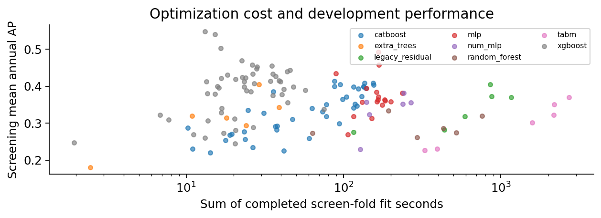
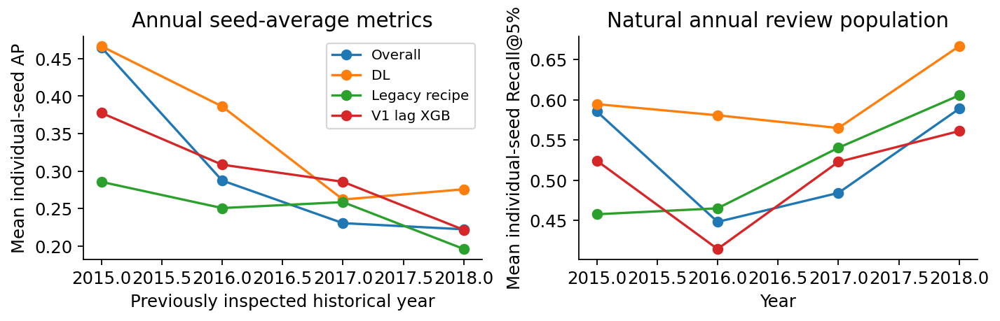

# Performance V2: measured deltas

Qidian (Martin) Xing | 78,682 firm-years, 8,971 firms; 66,400 records through 2014; 12,282 previously inspected 2015-2018 records.

| Recipe | Cutoff | Input | Sel | Seeds | Yr AP | Pool AP | ROC | R@5 | Min | Source |
| --- | --- | --- | --- | --- | --- | --- | --- | --- | --- | --- |
| V0 base | 2011 | 18/01 | Y | 1 | NA | 0.145 | 0.835 | NA | NA | Archive |
| V0 L1 | 2011 | 13/01 | N | 1 | NA | 0.295 | 0.858 | NA | NA | Archive |
| V1 RF | 2012 | S1 | Y | 1 | 0.215 | 0.206 | 0.862 | 0.460 | 0.428 | V1 |
| V1 DL | 2012 | S1 | Y | 1 | 0.110 | 0.105 | 0.815 | 0.294 | 0.602 | V1 |
| P2 old L1 | 2014 | L1/01 | Pre | 5 | 0.262 | 0.259 | 0.862 | 0.524 | 2.798 | Mean score |
| P2 lag XGB | 2014 | Lag3/V1 | Pre | 5 | 0.303 | 0.296 | 0.853 | 0.513 | 0.605 | Mean score |
| P2 Cat raw | 2014 | RAW/V1 | Pre | 5 | 0.279 | 0.271 | 0.852 | 0.488 | 0.583 | Mean score |
| P2 V1 RF | 2014 | S1/V1 | Pre | 5 | 0.286 | 0.286 | 0.891 | 0.504 | 1.399 | Mean score |
| P2 V1 DL | 2014 | S1/V1 | Pre | 5 | 0.228 | 0.214 | 0.874 | 0.462 | 1.057 | Mean score |
| P2 overall | 2014 | LEGACY33/native/half-life3 | Y | 5 | 0.313 | 0.325 | 0.904 | 0.540 | 0.331 | Mean score |
| P2 DL | 2014 | RAW17/01/half-life3 | Y | 5 | 0.393 | 0.392 | 0.912 | 0.621 | 5.487 | Mean score |
| P2 blend | 2014 | annual ranks | Y | 5 | 0.373 | 0.383 | 0.922 | 0.620 | NA | Rank blend |
| Rank old L1 | 2014 | annual ranks | Pre | 5 | 0.262 | 0.254 | 0.861 | 0.524 | NA | Rank reference |
| Rank lag XGB | 2014 | annual ranks | Pre | 5 | 0.303 | 0.300 | 0.853 | 0.513 | NA | Rank reference |
| Rank Cat raw | 2014 | annual ranks | Pre | 5 | 0.279 | 0.270 | 0.851 | 0.488 | NA | Rank reference |
| Rank V1 RF | 2014 | annual ranks | Pre | 5 | 0.286 | 0.281 | 0.892 | 0.504 | NA | Rank reference |

The development-selected fixed annual-rank blend has historical annual AP 0.373, versus 0.303 for the strongest frozen same-cutoff baseline point estimate (baseline_v1_lags_xgb). The difference is +0.070. It exceeds all four annual-AP baseline point estimates. All four paired annual-AP lower bounds are positive under the conditional company bootstrap.

Yr AP is equal-weight annual AP; Pool AP and ROC pool years; R@5 averages annual review recall. Min is measured fit time. Mean-score ensembles differ from mean seed metrics. Sel is selection within each version/family. Archive rows are source observations, not new experiments. Annual ROC guardrails and full identities are in selection_trace.csv and baseline_bridge.csv.

# 2. Why the legacy recipe could look stronger

| 2012 controlled recipe | AP | Seconds |
| --- | --- | --- |
| xgb_raw_keepbest | 0.239 | 0.654 |
| legacy192_s1 | 0.206 | 22.082 |
| legacy192_raw18 | 0.249 | 59.504 |
| xgb_LAGS_RAW3 | 0.333 | 6.668 |
| legacy192_inner_l1 | 0.214 | 170.366 |
| xgb_RATIO_CORE | 0.291 | 6.149 |
| xgb_RAW17 | 0.285 | 1.123 |
| legacy192_epochrefit | 0.256 | 62.872 |
| legacy192_raw17 | 0.325 | 196.214 |
| legacy192_clip005 | 0.314 | 157.399 |
| legacy192_quantile | 0.243 | 26.896 |
| legacy64_raw18 | 0.259 | 18.227 |
| legacy192_keepbest | 0.263 | 37.591 |
| legacy192_unweighted | 0.364 | 117.674 |
| legacy192_ros_steps | 0.392 | 141.263 |
| legacy192_ros_epochs | 0.417 | 234.856 |

The legacy residual network has width 192/four blocks and about 302k parameters, versus 36,801 for the V1 selected width 64/two-block ROS pipeline. The latter used 18 final epochs; the V1 core table used a different 16-epoch configuration. Inputs, clipping, loss weights, stopping information and refitting also changed.

Legacy and sklearn AP agree on actual saved predictions and tied-score fixtures. Capacity differences therefore establish a changed experiment, not an automatic explanation of generalization. These seed 42/single-year controls provide conditional mechanism evidence, not universal causal attribution. The included epoch 31 checkpoint is distinct from the bridge epoch 23 record; exact archived 13 selection never enters early P2 development folds.

In the fixed 2012 control, reducing RAW18 capacity from 192 x 4 to 64 x 2 changes AP from 0.249 to 0.259; this does not support bigger-is-always-better. Removing only the duplicate raw column gives 0.325; removing full class weighting gives 0.364. These are local mechanism sensitivities, not a causal decomposition of the historical version gap.

Actual archive-role results: original-loop fixed-13 retraining has pooled AP 0.225; the included epoch 31 checkpoint gives 0.140. The former does not reproduce archived 0.295; the latter is not the archived epoch 23 artifact. An archive-cache row permutation was corrected for these two rows, then every frozen pipeline was reloaded in source-row order, without new fitting or selection changes.

# 3. Training budgets and numerical representation

| Fixed-update control | Updates | Positive exposures | Train BCE |
| --- | --- | --- | --- |
| bridge_equal2000_none__seed42__year2012 | 2000 | 80778 | 0.246 |
| bridge_equal2000_smote__seed42__year2012 | 2000 | 509988 | 0.498 |
| bridge_equal2000_ros__seed42__year2012 | 2000 | 509988 | 0.480 |

Three treatments receive 2,000 actual updates. Numerical transforms and bin knots fit current training roles only; binary masks bypass quantile mapping. Constant/duplicate masks are removed without dropping records. Official numerical embedding modules and TabM are used; TabM averages per-head losses during training and per-head sigmoid probabilities at inference.

A V2 migration error in the V1 ROS epoch-equivalent refit used the natural row count. That trial was invalidated, retained and replaced before selection. It was not a defect in preserved V1 code, and ordinary P2 step-refit HPO was unaffected.

# 4. Search coverage, selection and confirmation

| Family | Complete | Failed | Pruned |
| --- | --- | --- | --- |
| catboost | 36 | 0 | 0 |
| xgboost | 36 | 0 | 0 |
| random_forest | 6 | 0 | 0 |
| extra_trees | 6 | 0 | 0 |
| legacy_residual | 6 | 0 | 0 |
| mlp | 6 | 0 | 0 |
| num_mlp | 6 | 0 | 0 |
| tabm | 6 | 0 | 0 |
| official_ft | 0 | 0 | 0 |
| xgb_rank | 0 | 0 | 0 |

Screening years are 2009/2011/2013. Shortlisted candidates complete all five 2009-2013 years and three registered seeds. Selection averages seed/year AP, with 0.005 near-tie tolerance, recent-year/review-capacity/cost tie-breaks and ROC/Top5 guardrails. Strong fixed baselines remain eligible. Candidate/blend choices freeze before one 2014 confirmation batch; confirmation cannot reopen search.

# 5. Historical evidence against strong baselines

The development-selected fixed annual-rank blend has historical annual AP 0.373, versus 0.303 for the strongest frozen same-cutoff baseline point estimate (baseline_v1_lags_xgb). The difference is +0.070. It exceeds all four annual-AP baseline point estimates. All four paired annual-AP lower bounds are positive under the conditional company bootstrap.

Descriptively, the overall single recipe's raw pooled AP is 0.325, versus archived legacy L1 0.295 (+0.029). Different cutoff/selection/seed roles prevent attributing this archive difference to the algorithm; it is separate from the same-cutoff annual-AP comparison.

| Same-cutoff reference | Annual AP delta low | High | Draws |
| --- | --- | --- | --- |
| baseline_legacy_strong_inner_l1 | 0.039 | 0.186 | 2000 |
| baseline_v1_lags_xgb | 0.002 | 0.144 | 2000 |
| baseline_v1_raw_catboost | 0.029 | 0.166 | 2000 |
| baseline_v1_selected_rf | 0.032 | 0.148 | 2000 |

The archived L1 pooled AP 0.295332 came from one seed and different selection/training roles and was not the old validation-ROC-selected representative. P2 retrains every comparison baseline through 2014. P2-selected cutoff 2012 transfers are explicitly separate from strict P1. Annual-rank pooled AP is compared only with matching annual-rank baselines.

# What changed: measured recipe and confirmation

overall selected recipe: {"depth": 8, "family": "xgboost", "features": "LEGACY33", "half_life": 3, "iterations": 1500, "learning_rate": 0.07016184471619624, "preprocess": "native", "sampling": "none", "weight_alpha": 0}; five-year/three-seed AP=0.529.

DL selected recipe: {"depth": 2, "family": "mlp", "features": "RAW17", "half_life": 3, "learning_rate": 0.001, "preprocess": "std01", "sampling": "none", "schedule": "fixed", "weight_alpha": 0, "width": 128}; five-year/three-seed AP=0.500.

| Backbone | Input/scale | No embedding AP | PLE AP | Change |
| --- | --- | --- | --- | --- |
| num_mlp | RAW/01 | 0.382 | 0.357 | -0.025 |
| num_mlp | Log/QT | 0.324 | 0.356 | 0.033 |
| tabm | RAW/01 | 0.323 | 0.351 | 0.029 |
| tabm | Log/QT | 0.231 | 0.301 | 0.070 |

| One 2014 confirmation | AP | ROC | R@5 |
| --- | --- | --- | --- |
| Overall | 0.572 | 0.906 | 0.592 |
| DL | 0.527 | 0.905 | 0.556 |
| legacy_strong_inner_l1 | 0.311 | 0.823 | 0.430 |
| v1_lags_xgb | 0.311 | 0.822 | 0.401 |
| v1_selected_rf | 0.422 | 0.877 | 0.493 |

Neural single recipe: selected DL annual AP=0.393; same-cutoff V1 DL=0.228 (difference +0.165), legacy L1=0.262 (difference +0.131). These are historical point estimates from mean five-seed predictions; stability and intervals are reported separately.

PLE deltas are matched-backbone, one-seed, three-year development results. Multivariable final changes support pipeline comparisons; the 2014 batch never triggers reselection.

Fixed selected recipe and seed 42, changed fit cutoff: annual AP=0.242 through 2012 versus 0.305 through 2014. This P2-selected transfer used 2013 selection information and is not strict P1; rolling recipes shift the start with the same window-length rule.

Compute disclosure: the first eight-hour window expired with partial development evidence. The owner explicitly authorized a separately registered additional eight-hour continuation. Both clocks and prior partial outputs are preserved; final results use additional authorized compute. Actual timing and fit calls are in experiment_summary and fit_accounting.

Three-year development input controls under the same tree recipe: RAW17=0.400, RATIO_CORE=0.322, LAGS_RAW3=0.392. These seed 42 conditional controls retain exact configs/deltas in matched_input_controls.csv.

Development-only one-factor controls: xgboost half_life=3: 0.458 -> 0.548; mlp half_life=3: 0.382 -> 0.493. A three-year half-life halves relative weight at three years of age, normalized to mean one; evaluation records are unchanged. Economic explanations require event dates, and historical pipeline gains are not isolated causal effects.

# 6. Cost, uncertainty and reproducibility

| Recipe | Seeds | Mean annual AP | Min | Max |
| --- | --- | --- | --- | --- |
| baseline_legacy_strong_inner_l1 | 5 | 0.248 | 0.225 | 0.300 |
| baseline_logistic | 1 | 0.169 | 0.169 | 0.169 |
| baseline_v1_lags_xgb | 5 | 0.298 | 0.294 | 0.304 |
| baseline_v1_raw_catboost | 5 | 0.274 | 0.262 | 0.284 |
| baseline_v1_selected_dl_corrected_step | 5 | 0.181 | 0.161 | 0.211 |
| baseline_v1_selected_rf | 5 | 0.281 | 0.273 | 0.295 |
| refine_r3_15_a028aa7a | 5 | 0.301 | 0.293 | 0.316 |
| refine_r3_21_bbf84fb1 | 5 | 0.348 | 0.327 | 0.388 |

Paired company bootstrap uses 2,000 draws and carries all annual records together. Intervals condition on fitted models and the current historical sample; they omit full HPO/training uncertainty and common macro shocks. Rank comparisons additionally fix original cohort maps. The company holdouts are accurately labeled post-selection stress, and 2014-cutoff naturally unseen failed firms are few.

All trials, invalidated/failed attempts, prediction coverage, final artifacts and numerical checks are retained. The local model directory contains preprocessing, feature order, states, configs and fit histories; raw data, complete predictions and private cases are excluded from public Git. Reload/prediction commands and exact dependencies are in README and requirements_v2.txt.

This is an owner-directed, Codex-assisted independent extension of an earlier UCLA MFE 413 team project. Parent acknowledgements remain intact. Company-constant labels, missing event/publication dates and prior historical exposure preclude verified one-year PD or prospective deployment claims. Official primary implementation sources and versions are documented; no paper benchmark performance is assumed.

The DL representative has historical annual AP 0.393, above the development-frozen blend at 0.373. Fusion did not improve historical DL AP. The frozen choice is retained rather than replacing it with the highest historical row.

| Role | Groups | AP mean | Min | Max | R@5 |
| --- | --- | --- | --- | --- | --- |
| DL | 3 | 0.138 | 0.077 | 0.206 | 0.413 |
| ML | 3 | 0.143 | 0.097 | 0.206 | 0.360 |

The common pre-2015 population leaves 468 naturally unseen companies, including 5 failed firms. Actual rolling-window fitting sets were registered separately before final fitting. The table reports mean/range of pooled AP over three company groups, not confidence intervals; hyperparameters were selected on broader companies.
