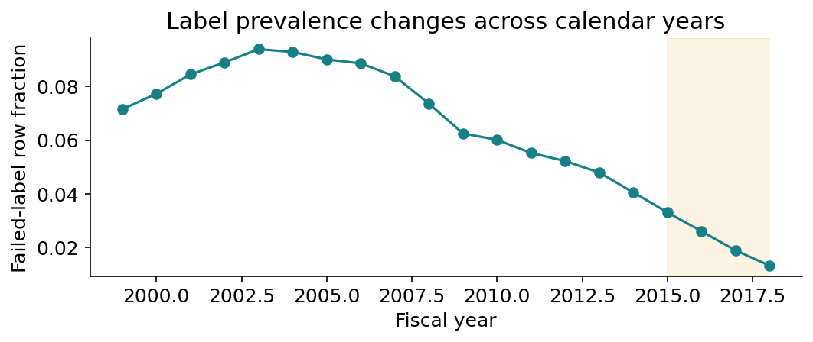
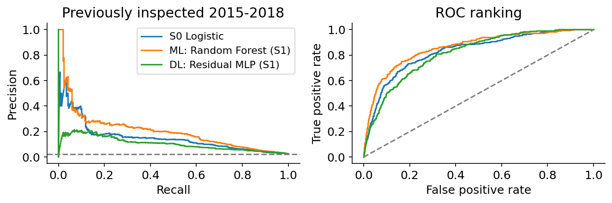
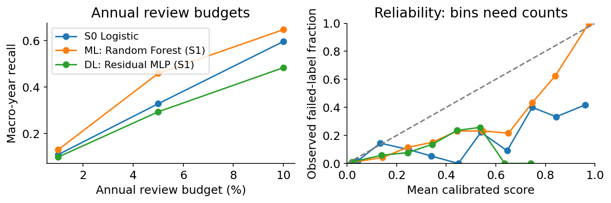
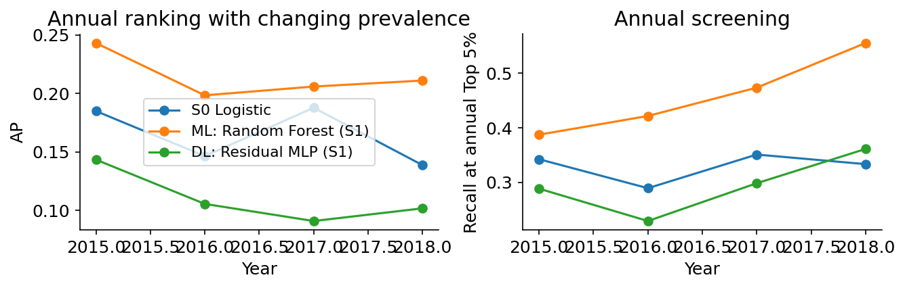
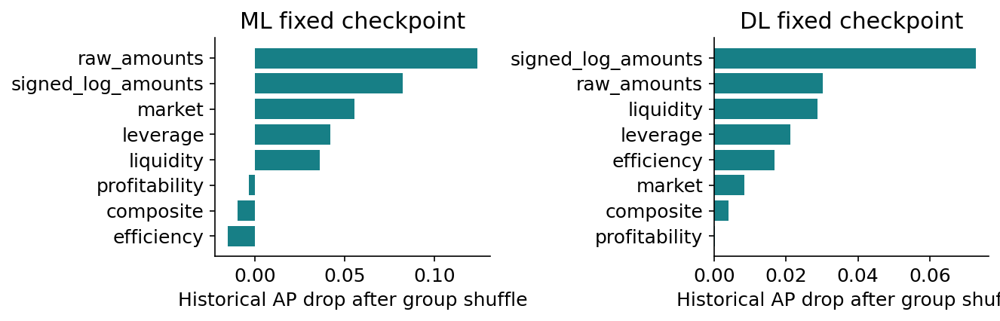

# Corporate Financial Distress

A Reproducible ML & Deep Learning Benchmark - Independent Extension

Qidian (Martin) Xing | Research date: 2026-10-16

This study compares financial features, traditional estimators and compact PyTorch networks on 78,682 firm-year records. The target is the observed company-constant failed label. It is retrospective classification, not verified one-year-ahead bankruptcy prediction.

Models selected using seven development scoring years achieved previously inspected historical AP of 0.206 (Random Forest, S1) and 0.105 (Residual MLP, S1), compared with 0.153 for the same-protocol S0 Logistic baseline. These numbers describe one frozen seed-42 run; seed variability and paired company intervals are reported separately.

The main contribution is an auditable comparison: fold-local preprocessing and selection, separate calibration and decision years, budgeted screening, same-row feature/sampling ablations, and time-constrained company-disjoint stress tests. The earlier team project already compared ML and neural models. This extension does not claim to introduce those methods.

Reading map: data/labels (2), validation (3), information sets (4), model training (5), development (6), ablations (7), historical ranking (8), decisions/calibration (9), company generalization (10), uncertainty (11), sequences (12), interpretation (13), reproducibility and limits (14).

Scope: research and risk-ranking demonstration. Historical test exposure, unknown event/filing dates, changing class prevalence and repeated company observations constrain every performance claim.

# 2. Data identity and label limits

| Role | Rows | Companies | Positive rows | Fraction |
| --- | --- | --- | --- | --- |
| final_fit | 59412 | 7980 | 4624 | 0.078 |
| calibration | 3484 | 3484 | 167 | 0.048 |
| decision | 3504 | 3504 | 142 | 0.041 |
| historical_previously_inspected | 12282 | 3700 | 287 | 0.023 |

The original CSV copies have identical SHA-256 hashes. The audit found no missing raw cells or duplicate company-years. X9 (net sales) and X16 (revenue) are identical, so the main raw information set contains 17 variables. Negative net income, EBIT and retained earnings are economically meaningful; they are not deleted.



Labels are constant within all 8,971 companies. True bankruptcy dates, financial-statement publication dates and when the label became knowable are missing. Restricting input fiscal years does not establish point-in-time label availability. The last observed year is never treated as a failure date.

Live upstream comparison aligns IDs, years and labels but finds different financial values and extra sector columns. The local snapshot remains fixed. Units, currency, restatement treatment and exact upstream-version relationship remain unresolved. Dataset acquisition/rights checks are documented; no raw data is redistributed.

# 3. Temporal validation and isolation

| Fold / role | Fit years | Scoring / function |
| --- | --- | --- |
| D1 | 1999-2005 | 2006-2007 |
| D2 | 1999-2007 | 2008-2009 |
| D3 | 1999-2009 | 2010-2011 |
| D4 | 1999-2011 | 2012 |
| Final model | 1999-2012 | No later labels in base fit |
| Calibration | 2013 | Natural-prevalence Platt fit |
| Decision | 2014 | Freeze one F1 threshold |
| Historical | 2015-2018 | Previously inspected evaluation |

The selection objective is the equal-weight mean of AP across the seven development scoring years. Each calendar year has equal influence despite different sample sizes. Secondary diagnostics include annual recall at Top 5%, ROC-AUC, worst-year AP and cost. Development selection scores are optimistic estimates of the selection process, not independent final evidence.

For neural networks and boosting, the last year inside the current training window is the stopping set. A preliminary model determines training length; a new preprocessor and model are then fitted to the complete training window at that fixed length. The outer scoring labels do not determine epochs, imputation values, quantiles, scaling or selected features.

Development loading never parses labels beyond 2012. Calibration and threshold roles become available only to final-artifact training. The historical command verifies protocol, artifact and source hashes before opening historical labels once. Reproduction subsequently reloads saved artifacts and checks predictions; it does not retune.

The historical period was exposed in the original project and cannot be made untouched through a new split or company hash. A substantive scoring bug would require an explicit invalidation/amendment and a new run, preserving prior evidence.

# 4. Registered financial information sets

| Set | Information | Causality / invalid rules |
| --- | --- | --- |
| S0 | 17 deduplicated financial amounts | Current fiscal record only |
| S1 | S0, signed logs, 12 unique ratios, working capital, Altman composite and invalid flags | Current positive denominators; NaN plus masks otherwise |
| S2 | S1 plus exact annual changes, three-calendar-year summaries, positive log growth, losses and coverage | Only t, t-1 and t-2; gaps remain gaps |
| LAGS | Three exact calendar snapshots with observed flags | Same target rows, explicit missing slots |

Signed log: sign(x) * log(1 + abs(x)). For example, a loss remains negative while its magnitude is compressed. Ratios express liquidity, profitability, total-liability leverage, operating efficiency and market-value coverage. X17/assets is total liabilities/assets, not exclusively interest-bearing debt. Denominators are current-year values rather than average balances.

Nonpositive financial ratio denominators create NaN and an invalid flag. Tiny positive values are retained for transparent train-only clipping rather than replaced by arbitrary constants. Median imputation, missing masks, optional 0.5/99.5-percentile clipping, and scaling are fitted only to the training role. A no-clipping ablation tests whether this protection is beneficial.

Dynamic features use exact calendar joins. If t-1 is absent, a t-2 row cannot become a one-year change. Three-year summaries use the observed slots and report coverage. No backward fill, centered window, future record count, final year, remaining lifetime, ID suffix or label enters a model tensor.

Every feature has a formula, source columns, economic group, timing and invalid-value rule in feature_registry.csv. Constant and exact duplicate transformed columns are removed using training data only. Additional columns are justified by controlled information-set comparisons, not by feature count.

# 5. Models, optimization and actual cost

| Family | Input dims | NN / linear params | Fixed epochs / trees | Fit seconds |
| --- | --- | --- | --- | --- |
| Random Forest | 49 | NA | 120 | 22.113 |
| CatBoost | 49 | NA | 180 | 12.275 |
| XGBoost | 49 | NA | 180 | 8.367 |
| Residual MLP | 49 | 36801.000 | 16 | 23.684 |
| MLP | 49 | 7425.000 | 10 | 12.649 |
| FT-Transformer | 49 | 6081.000 | 10 | 341.859 |
| Logistic L2 | 49 | 50.000 | 53 | 2.745 |

Baselines are training prevalence and the negative Altman Z-score. Learned models comprise L2 Logistic, Random Forest, XGBoost, regularized MLP, Residual MLP, compact FT-Transformer and available CatBoost. Elastic Net is tested as a nested embedded selector. No network is presumed superior: deep learning is a subset of machine learning.

MLP uses two dense blocks. Residual MLP adds normalized skip blocks. FT-Transformer learns a weight and bias token for each numeric feature, adds a CLS token and applies two small attention layers. It is an independent educational implementation inspired by the tabular-model paper, not a reproduction of the paper benchmark. Attention acts across features; it does not create a time series.

PyTorch training uses AdamW, dropout, weight decay, shuffled deterministic DataLoaders, BCEWithLogitsLoss, finite-gradient checks and gradient clipping. Sigmoid is applied for probabilities after logits. The networks use train mode for updates and eval/inference mode for scoring; round-trip checkpoint tests verify prediction consistency.

All measured runs use local CPU, two threads and one neural experiment process. A first XGBoost pilot crashed because two OpenMP runtimes were loaded; sharing the PyTorch runtime resolved the conflict. Exact KD-tree neighbors avoid a separate SMOTE dispatcher crash. Failed diagnostics remain logged. No paid service or system-Python modification was used.

# 6. Development and frozen feature transfer

| Family | S0 macro-year AP | S1 macro-year AP |
| --- | --- | --- |
| Altman -Z | 0.104 | 0.104 |
| CatBoost | 0.226 | 0.246 |
| Prevalence | 0.068 | 0.068 |
| FT-Transformer | 0.174 | 0.189 |
| Logistic L2 | 0.160 | 0.172 |
| MLP | 0.185 | 0.192 |
| Random Forest | 0.266 | 0.290 |
| Residual MLP | 0.197 | 0.206 |
| XGBoost | 0.225 | 0.232 |

Measured S1-minus-S0 development AP changes: CatBoost +0.021; FT-Transformer +0.015; Logistic L2 +0.012; MLP +0.007; Random Forest +0.024; Residual MLP +0.009; XGBoost +0.008.

| Frozen historical AP | S0 | S1 |
| --- | --- | --- |
| CatBoost | 0.243 | 0.208 |
| FT-Transformer | 0.209 | 0.221 |
| Logistic L2 | 0.153 | 0.189 |
| MLP | 0.212 | 0.189 |
| Random Forest | 0.219 | 0.217 |
| Residual MLP | 0.181 | 0.116 |
| XGBoost | 0.221 | 0.211 |

Only 2 of 7 learned fixed-recipe families have higher historical AP with S1 than S0. These are same-row point comparisons, not feature-specific significance tests. Development feature gains did not transfer uniformly.

The first table selects by seven development years. The second is frozen, previously inspected 2015-2018 evidence and never enters selection. Only the best S1 ML and DL core families received two extra pre-registered candidates each; all weak alternatives remain reported.

# 7. Controlled feature and imbalance ablations

| Changed factor | XGBoost AP | Residual MLP AP |
| --- | --- | --- |
| No clipping | 0.233 | 0.208 |
| ROS | 0.235 | 0.274 |
| S0 raw | 0.225 | 0.197 |
| S1 base | 0.232 | 0.206 |
| S2 dynamics | 0.242 | 0.191 |
| SMOTE | 0.195 | 0.240 |
| Weight alpha 0.5 | 0.237 | 0.189 |
| Weight alpha 1 | 0.235 | 0.190 |
| elastic_net | 0.229 | 0.188 |
| model_aware | 0.232 | 0.205 |

Measured S2-minus-S1 development AP changes: XGBoost +0.010; Residual MLP -0.015. The largest intervention delta was Residual MLP / ROS (+0.068 AP). XGBoost / SMOTE did not improve the base recipe (-0.038). These selected extrema are descriptive development observations, not unbiased final estimates.

Every row uses the same four expanding folds, natural scoring proportions and seed 42. S0/S1/S2 compare information; other rows change one element of the S1 recipe. The full controlled table reports AP deltas, feature dimensions and training cost. The optimized final pipeline comparison is a separate question because its feature set or regularization may differ.

Class weights derive from the current training role: (N_negative/N_positive)^alpha, with alpha 0, 0.5 or 1. ROS and SMOTE are separate from weighting. Both resample only training inputs after appropriate scaling. ROS controls for extra minority exposure; SMOTE adds interpolations, which need not preserve accounting relationships or represent new companies.

Elastic Net chooses C and L1 ratio in an inner tail-year split, then selects nonzero coefficients after an outer-training refit. Group-aware selection ranks economic groups using two earlier cross-fitted tree validations, then chooses top 2, top 4 or all groups on a later inner year. Neither selector sees outer scoring labels. No selection remains a genuine candidate.

A negative AP delta is retained as a failed improvement, not removed. Clipping, selecting variables, resampling and adding architecture are empirical choices with costs; none is assumed to improve every model or year.

# 8. Frozen historical ranking

| Pipeline | Set | AP | ROC-AUC | Annual R@5% |
| --- | --- | --- | --- | --- |
| Random Forest (core) | S1 | 0.217 | 0.864 | 0.481 |
| CatBoost (core) | S1 | 0.208 | 0.857 | 0.474 |
| XGBoost (core) | S1 | 0.211 | 0.856 | 0.493 |
| Residual MLP (core) | S1 | 0.116 | 0.826 | 0.324 |
| MLP (core) | S1 | 0.189 | 0.841 | 0.422 |
| FT-Transformer (core) | S1 | 0.221 | 0.839 | 0.469 |
| Logistic L2 (core) | S1 | 0.189 | 0.837 | 0.414 |
| Logistic L2 (core) | S0 | 0.153 | 0.833 | 0.329 |
| Altman -Z (core) | S1 | 0.048 | 0.746 | 0.072 |
| Prevalence (core) | S1 | 0.023 | 0.500 | 0.036 |
| Random Forest (selected) | S1 | 0.206 | 0.862 | 0.460 |
| Residual MLP (selected) | S1 | 0.105 | 0.815 | 0.294 |
| Equal-rank ensemble (ensemble) | ALL | 0.185 | 0.858 | 0.439 |

The evaluation contains 12,282 records and 287 positive rows, from 119 positive companies. Its prevalence is 0.0234. Pooled AP and macro-year AP answer different weighting questions; both are saved. Use same-row paired differences, not an AP ratio across years with different prevalence.

The development-selected ML AP is 0.206, versus 0.153 for S0 Logistic; the selected DL AP is 0.105. The DL pipeline does not reproduce its development advantage. The fixed ensemble also failed to improve on the selected tree in this historical period. This is a retained transfer failure, not a reason to choose a different historical winner or adjust weights.

Core S1 rows provide a controlled family comparison. Representative rows describe optimized pipelines, including their information set. Extra tuned configurations from the same family remain identifiable by config_id in the machine tables. Old team scores follow different roles and are not used as an improvement denominator.

# 8.2. Ranking and review-budget curves





PR curves describe precision-recall tradeoffs over the frozen score ordering. ROC curves describe ranking across both classes. The annual review curve instead fixes capacity at 1%, 5% or 10%; it does not find a favorable historical threshold.

The reliability plot compares mean score with observed failed-label fraction, using saved natural-prevalence predictions. Sparse bins can be unstable. These score probabilities remain tied to the retrospective label, not an event-defined annual PD.

# 9. Screening and probability quality

| Rep. | Precision | Recall | F1 | Alert share | Brier |
| --- | --- | --- | --- | --- | --- |
| ML | 0.207 | 0.411 | 0.276 | 0.046 | 0.025 |
| DL | 0.115 | 0.366 | 0.175 | 0.074 | 0.026 |

| Rep. | Period | Raw Brier | Platt Brier | Raw log loss | Platt log loss |
| --- | --- | --- | --- | --- | --- |
| ML | 2014 decision | 0.035 | 0.033 | 0.146 | 0.130 |
| ML | 2015-2018 | 0.026 | 0.025 | 0.125 | 0.103 |
| DL | 2014 decision | 0.132 | 0.035 | 0.399 | 0.141 |
| DL | 2015-2018 | 0.144 | 0.026 | 0.427 | 0.109 |

Annual Top 1%, 5% and 10% use score-only ordering, ceil(budget*n) and a deterministic company/year hash for ties. The capacity is fixed before looking at outcomes. Lift divides selected precision by the same year's positive fraction. It is a risk-screening statistic, not a realized financial return.

One fixed threshold maximizes F1 on 2014 calibrated predictions. Historical precision, recall, F1 and confusion counts use that frozen threshold. A large change in the historical alarm fraction is possible under distribution shift; threshold metrics must be interpreted alongside review budgets.

Platt calibration fits only on natural-prevalence 2013 data, without refitting the base model afterward. Uncalibrated scores, 2014 probability quality, historical Brier/log loss and reliability-bin counts are preserved. Brier and log loss assess probability prediction quality, not pure calibration error. A calibrated failed-label probability is still not an annual default PD.

# 10. Time and company generalization



| Family | Seen by 2012 | Companies | Failed firms | AP | CI low | CI high |
| --- | --- | --- | --- | --- | --- | --- |
| Random Forest | seen | 2790 | 103 | 0.256 | 0.183 | 0.338 |
| Random Forest | unseen | 910 | 16 | 0.112 | 0.025 | 0.257 |
| Residual MLP | seen | 2790 | 103 | 0.127 | 0.089 | 0.180 |
| Residual MLP | unseen | 910 | 16 | 0.049 | 0.014 | 0.148 |

| Untuned stress | Groups | Min AP | Mean AP | Max AP |
| --- | --- | --- | --- | --- |
| Logistic L2 | 3 | 0.089 | 0.154 | 0.236 |
| Residual MLP | 3 | 0.063 | 0.091 | 0.134 |
| XGBoost | 3 | 0.081 | 0.146 | 0.205 |

Seen/unseen is relative to the actual 2012 base-fit cutoff. The unseen subset contains only 16 failed companies; its score can be unstable even with many rows. A separate 2014-cutoff sensitivity includes an even smaller positive cohort and is not silently omitted.

Company stress holds out each of three fixed SHA256 groups from all fitting, stopping and calibration roles. Logistic, Boosting and Residual MLP use the recipes fixed before development, not globally tuned winners. This is explicitly an untuned sensitivity analysis. Its training population is smaller, so direct differences from full-company models mix training coverage and novelty.

# 11. Uncertainty and seed sensitivity

| Representative | AP CI low | AP CI high | Delta low | Delta high | Draws |
| --- | --- | --- | --- | --- | --- |
| ML | 0.146 | 0.277 | -0.002 | 0.102 | 2000 |
| DL | 0.074 | 0.148 | -0.111 | 0.003 | 2000 |
| Ensemble | 0.132 | 0.258 | -0.033 | 0.092 | 2000 |

| Family | Set | Seeds | Mean AP | Min AP | Max AP |
| --- | --- | --- | --- | --- | --- |
| Random Forest | S1 | 5 | 0.198 | 0.190 | 0.206 |
| Residual MLP | S1 | 5 | 0.114 | 0.104 | 0.130 |

ML delta AP [-0.002, +0.102] crosses zero; DL delta AP [-0.111, +0.003] crosses zero; Ensemble delta AP [-0.033, +0.092] crosses zero. All interval statements are conditional on the fitted models and current clustered sample.

Paired cluster bootstrap samples companies with replacement, carrying all their annual records together. All models share each draw. Integer company multiplicities preserve repeated observations and annual capacities; 2,000 draws produce percentile intervals. Single-class invalid draws are counted rather than assigned artificial scores.

Delta intervals compare each development-selected representative with the same-protocol S0 Logistic baseline. An interval crossing zero does not support a confident positive difference under this procedure. An interval wholly above zero is still conditional on these fitted models, this historical population and the cluster scheme; it does not eliminate test exposure or model-selection uncertainty.

The five registered seeds are all retained. Their mean and range describe stochastic training variation on the same evaluation population, not five independent tests. Seed 42 is the preselected main run; no best historical seed is substituted. Seed averaging is not represented as a single model or as independent data replication.

Company bootstrap does not fully represent shared macroeconomic shocks, upstream data revisions, point-in-time label availability or future-regime uncertainty. Rank-ensemble intervals also hold the original annual rank-reference cohorts fixed; they do not rebuild ranks for a new universe. Four historical years provide descriptive temporal evidence rather than broad coverage of economic states.

# 12. Annual trajectories and finite ensemble

| Controlled family | Set | Dev AP | Historical AP | Hist ROC |
| --- | --- | --- | --- | --- |
| GRU | LAGS | 0.170 | 0.170 | 0.832 |
| MLP | LAGS | 0.170 | 0.237 | 0.834 |
| MLP | S0 | 0.185 | 0.212 | 0.829 |
| XGBoost | LAGS | 0.221 | 0.258 | 0.844 |
| XGBoost | S0 | 0.225 | 0.221 | 0.841 |

| Fixed-rank OOF candidate | Development AP |
| --- | --- |
| DL | 0.274 |
| ML | 0.338 |
| equal_rank_ensemble | 0.362 |

The GRU receives [batch, 3 calendar slots, feature] rather than treating financial columns as time. A shared snapshot preprocessor is fitted only on current training-role records. For missing calendar slots, numerical inputs are zeroed and an observed flag is zero; target-year rows remain present. The recurrent output at the target year feeds a logit head.

Snapshot S0 tree/MLP, flattened three-year tree/MLP and GRU are evaluated on identical target rows. This separates the availability of historical inputs from a recurrent architecture. The flattened controls may learn lag-specific transforms; the GRU shares feature scaling over time. They compare practical pipelines on the same information, not perfectly identical parameterizations.

The optional window is fixed at three years. No ordinary SMOTE is applied to sequence tensors. Short histories and internal gaps are retained rather than filtering failure companies away. Calendar masks carry coverage information and can themselves reflect selection processes; their presence is disclosed.

Sequence modeling does not supply missing event dates. All outputs predict the same retrospective ultimate-status label. Any improvement is evidence about information/architecture under this dataset and protocol, not an established advance in one-year event forecasting.

The equal-rank candidate uses one half ML and one half DL OOF rank per calendar year. It requires an annual scoring cohort, and any accepted ensemble has its own disjoint 2013 calibration and 2014 threshold. Rejected candidates remain in ensemble_development.csv; there is no stacking on in-sample predictions.

# 13. Interpretation, stability and errors



| Family | Selector | Mean Jaccard | Union size |
| --- | --- | --- | --- |
| Residual MLP | elastic_net | 0.613 | 42 |
| Residual MLP | model_aware | 1.000 | 60 |
| XGBoost | elastic_net | 0.613 | 42 |
| XGBoost | model_aware | 1.000 | 60 |

Linear coefficients are conditional on other correlated inputs and their standardization. Selector coefficients and per-fold feature lists are exported. Jaccard overlap measures descriptive selection stability across time windows; it is not a significance test. A sparse linear selector can discard variables useful in nonlinear interactions.

Failure cases follow a registered rule: the smallest SHA256 within each TP, FP, FN and TN cell. IDs, financial context and predictions remain in the local case file. Public profiles report cell counts and medians only. This avoids choosing only persuasive anecdotes and avoids publishing the full row-prediction dataset.

False positives may resemble financially weak ultimate survivors; false negatives may have financial patterns similar to ultimate survivors or incomplete temporal information. These are possible interpretations, not verified causal histories. Neither attention weights nor permutation establishes why a company failed. All case analysis occurs after freeze and cannot feed back into this version.

# 14. Reproducibility, attribution and next work

```python
scripts/run.sh -m pytest -q
scripts/run.sh -m distress_ml.cli audit
scripts/run.sh -m distress_ml.cli develop --stage all
scripts/run.sh -m distress_ml.cli sequences
scripts/run.sh -m distress_ml.cli freeze
scripts/run.sh -m distress_ml.cli historical-evaluate
scripts/run.sh -m distress_ml.cli report
```

To reproduce an existing artifact, run the reproduce command with its final model label; this reloads the checkpoint and checks scores against saved local predictions. predict accepts a raw input CSV, with company/year history when required. Full retraining requires the exact authorized data hash, the pinned environment and a fresh run directory; the historical lock is intentionally not bypassed.

The local artifact package stores preprocessing, feature order, model state, calibration, threshold, budget rules, configuration, environment, hashes, train histories and row predictions. Public release includes only new implementation, aggregate results, sanitized notebooks and reports. Source/processed data, original team materials, private communications, credentials and local resume drafts are excluded. No open-source license is inferred.

The extension is authored under Qidian (Martin) Xing's direction with disclosed Codex assistance. The earlier UCLA MFE 413 course submission remains credited to Gus Guenther, Zhixiang (Eason) Chen, Yingqi Fang, Qidian (Martin) Xing, Yiyang (Faye) Xie, Xiaoyue Wang and Xianghan Zhu. No claim is made that the owner manually wrote every line or has already independently reviewed the outputs.

Next research should obtain auditable event and statement-availability dates, verify source units/version history, register a genuine prospective or external holdout, and test calibration and review capacity under realistic operational constraints. New historical insights belong to a new registered version, not a retuned result in this report.

Primary references: scikit-learn common pitfalls, AP and calibration documentation; imbalanced-learn resampling pitfalls; Gorishniy et al. (2021), arXiv:2106.11959, and the authors' official rtdl-revisiting-models repository; sowide/bankruptcy_dataset README/license and requested data papers. Exact checked links appear in docs/REFERENCES.md.
